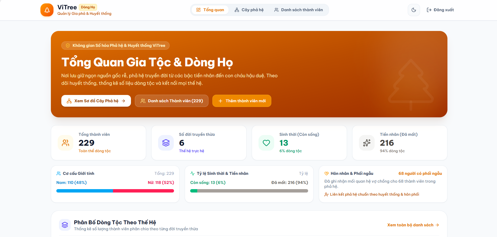
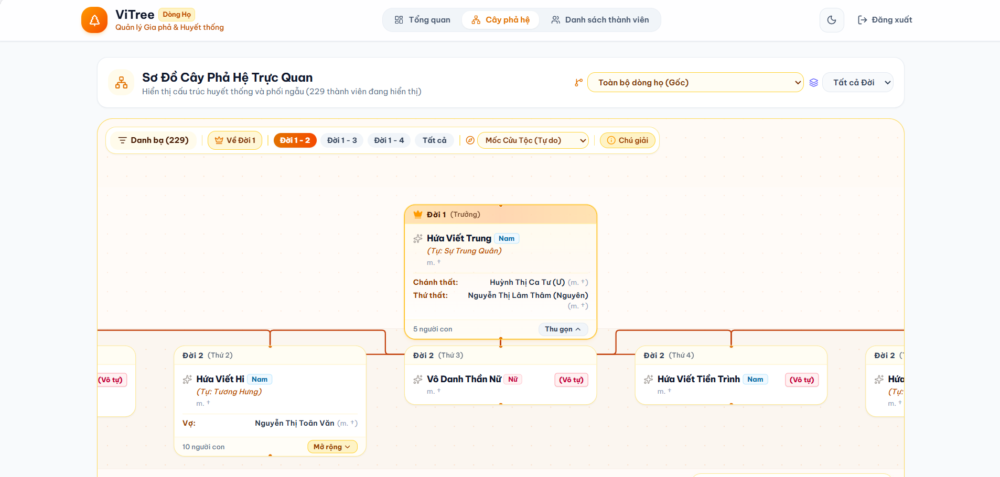
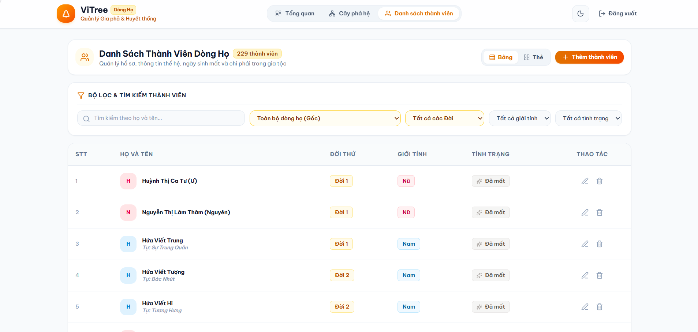
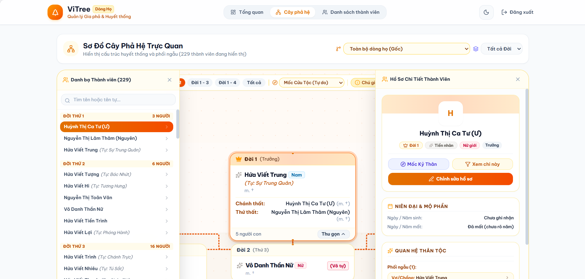

<div align="center">

  <h1>ViTree - Visual Family Tree &amp; Clan Heritage Management Portal</h1>
  <h3>Cổng Quản Lý Gia Phả Trực Quan, Phả Đồ Tương Tác &amp; Không Gian Lưu Trữ Kỷ Niệm Dòng Tộc</h3>

  <p>
    Nền tảng giao diện người dùng thế hệ mới phục vụ số hóa gia phả, kết nối cội nguồn và bảo tồn di sản dòng họ. 
    Trang bị không gian đồ họa tương tác phả đồ toàn diện trên nền tảng React Flow (XYFlow), thuật toán tự động bố cục 
    cây gia phả đa thế hệ, bảng điều khiển thống kê nhân khẩu học và lịch tưởng niệm ngày giỗ âm lịch chuẩn mực.
  </p>

  <p>
    
    
    
    
    
    
    
    
  </p>

</div>

<br />

# FRONTEND WEB PORTAL &amp; INTERACTIVE GENEALOGY DASHBOARD

Đây là kho lưu trữ chứa mã nguồn **Frontend** của hệ thống **ViTree** — Ứng dụng Quản trị Gia phả Trực quan và Số hóa Di sản Dòng họ. Ứng dụng được phát triển trên kiến trúc **Next.js App Router** hiện đại kết hợp trình biên dịch **Turbopack**, đảm bảo tốc độ phản hồi tức thì, tối ưu hóa công thái học người dùng và vận hành mượt mà ngay cả với dữ liệu phả đồ quy mô lớn.

Toàn bộ hệ thống thư viện cốt lõi đã được rà soát và nâng cấp lên các phiên bản an toàn mới nhất (Next.js `16.4.3`, React `19.3.1`), vá triệt để các lỗ hổng bảo mật nghiêm trọng (RCE trong xử lý tối ưu hóa ảnh `CVE-2026-96889`, sự cố unauthenticated RCE trong App Router Cache `GHSA-673q-mjm6-r5xr` và nguy cơ DoS trong Server Actions).

---

## Mục lục

- [1. Công nghệ &amp; Thư viện Cốt lõi](#1-công-nghệ--thư-viện-cốt-lõi)
  - [Khung Giao diện &amp; Nền tảng Ứng dụng](#khung-giao-diện--nền-tảng-ứng-dụng)
  - [Thiết kế Giao diện, Hoạt họa &amp; Kiểu chữ](#thiết-kế-giao-diện-hoạt-họa--kiểu-chữ)
  - [Trực quan hóa Phả đồ &amp; Đồ họa Tương tác](#trực-quan-hóa-phả-đồ--đồ-họa-tương-tác)
  - [Quản lý Trạng thái &amp; Giao tiếp Dữ liệu Máy chủ](#quản-lý-trạng-thái--giao-tiếp-dữ-liệu-máy-chủ)
- [2. Tính năng Giao diện &amp; Kiến trúc Trải nghiệm Người dùng](#2-tính-năng-giao-diện--kiến-trúc-trải-nghiệm-người-dùng)
  - [2.1. Bảng Tổng quan Di sản &amp; Thống kê Nhân khẩu học (`/`)](#21-bảng-tổng-quan-di-sản--thống-kê-nhân-khẩu-học-)
  - [2.2. Không gian Phả đồ Huyết thống Tương tác (`/tree`)](#22-không-gian-phả-đồ-huyết-thống-tương-tác-tree)
  - [2.3. Bảng Quản trị Danh sách Thành viên &amp; Phân cấp Thế hệ (`/members`)](#23-bảng-quản-trị-danh-sách-thành-viên--phân-cấp-thế-hệ-members)
  - [2.4. Hồ sơ Thành viên &amp; Tưởng niệm Ngày giỗ Âm lịch](#24-hồ-sơ-thành-viên--tưởng-niệm-ngày-giỗ-âm-lịch)
  - [2.5. Xác thực Người dùng &amp; Bảo vệ Tuyến đường (`/login`)](#25-xác-thực-người-dùng--bảo-vệ-tuyến-đường-login)
- [3. Demo Giao diện Người dùng](#3-demo-giao-diện-người-dùng)
- [4. Hướng dẫn Cài đặt &amp; Khởi chạy](#4-hướng-dẫn-cài-đặt--khởi-chạy)
- [5. Cấu trúc Thư mục Dự án](#5-cấu-trúc-thư-mục-dự-án)
- [6. Kết nối Backend API Service](#6-kết-nối-backend-api-service)
- [7. Tác giả](#7-tác-giả)

---

## 1. Công nghệ &amp; Thư viện Cốt lõi

Hệ thống được xây dựng trên nền tảng công nghệ Frontend hiện đại nhất trong hệ sinh thái React:

### Khung Giao diện &amp; Nền tảng Ứng dụng

| Công nghệ / Thư viện | Phiên bản | Vai trò Kỹ thuật |
| :--- | :--- | :--- |
| **[Next.js](https://nextjs.org/)** | `16.4.3` | Khung ứng dụng React App Router với Turbopack, vá triệt để lỗ hổng RCE `CVE-2026-96889` |
| **[React](https://react.dev/)** | `19.3.1` | Thư viện UI cốt lõi thế hệ React 19, tăng tốc render và tối ưu hóa xử lý đồng thời |
| **[React DOM](https://react.dev/)** | `19.3.1` | Tầng liên kết DOM chuẩn hóa cho React 19 |
| **[TypeScript](https://www.typescriptlang.org/)** | `^5.9.3` | Đảm bảo tính an toàn kiểu dữ liệu (Strict Type Safety) toàn diện trong toàn bộ mã nguồn |
| **[ESLint &amp; eslint-config-next](https://eslint.org/)** | `^9.39.5 / 16.4.3` | Kiểm soát chất lượng mã nguồn, quy chuẩn cú pháp và tiêu chuẩn Next.js |

---

### Thiết kế Giao diện, Hoạt họa &amp; Kiểu chữ

| Công nghệ / Thư viện | Phiên bản | Vai trò Kỹ thuật |
| :--- | :--- | :--- |
| **[Tailwind CSS](https://tailwindcss.com/)** | `^4.3.3` | Framework CSS Utility-first v4 với kiến trúc CSS-first hiệu năng cao qua `@tailwindcss/postcss` |
| **[@tailwindcss/postcss](https://tailwindcss.com/)** | `^4.3.3` | Trình biên dịch tích hợp PostCSS tối ưu hóa tốc độ biên dịch stylesheet |
| **[Lucide React](https://lucide.dev/)** | `^1.61.0` | Bộ biểu tượng SVG vector đồng bộ, sắc nét phục vụ bảng điều khiển và phả đồ |
| **[PostCSS](https://postcss.org/)** | `^8.5.14` | Công cụ xử lý chuyển đổi CSS hiện đại được chỉ định thông qua cơ chế overrides an toàn |

---

### Trực quan hóa Phả đồ &amp; Đồ họa Tương tác

| Công nghệ / Thư viện | Phiên bản | Vai trò Kỹ thuật |
| :--- | :--- | :--- |
| **[@xyflow/react](https://reactflow.dev/)** | `^12.12.0` | Động cơ biểu đồ node-edge tương tác, hỗ trợ zoom, pan, kéo thả phả đồ quy mô lớn |
| **[date-fns](https://date-fns.org/)** | `^4.4.0` | Xử lý định dạng ngày tháng dương lịch, tính toán niên đại và chu kỳ kỵ nhật |

---

### Quản lý Trạng thái &amp; Giao tiếp Dữ liệu Máy chủ

| Công nghệ / Thư viện | Phiên bản | Vai trò Kỹ thuật |
| :--- | :--- | :--- |
| **[Zustand](https://zustand.docs.pmnd.rs/)** | `^5.0.16` | Quản lý trạng thái Client tập trung, lưu đệm bộ lọc và thiết lập giao diện |
| **[Axios](https://axios-http.com/)** | `^1.20.0` | HTTP Client có cài đặt Interceptors tự động đính kèm JWT Bearer Token |
| **[js-cookie](https://github.com/js-cookie/js-cookie)** | `^3.0.8` | Điều phối lưu trữ và đồng bộ Access Token bảo mật trên trình duyệt |

---

## 2. Tính năng Giao diện &amp; Kiến trúc Trải nghiệm Người dùng

Ứng dụng phân chia kiến trúc giao diện theo các phân hệ nghiệp vụ độc lập:

### 2.1. Bảng Tổng quan Di sản &amp; Thống kê Nhân khẩu học (`/`)
* **Khối Chào mừng &amp; Định hướng Nhanh (Overview Hero):**
  Truyền tải thông điệp cội nguồn dòng tộc, hiển thị lối tắt dẫn tới không gian phả đồ và danh sách thành viên.
* **Bảng Chỉ số Nhân khẩu học Dòng họ (Clan Stat Cards):**
  Thống kê tổng số lượng thành viên, số thế hệ (đời) đã được ghi nhận, tỷ lệ cân bằng giới tính (Nam / Nữ) và số lượng tiên tổ đã quy tiên.
* **Phân Bố Thành Viên Theo Đời (Generation Breakdown):**
  Biểu đồ thanh phân bố tỷ trọng số lượng con cháu qua từng thế hệ, nhận diện nhanh sự phát triển của các nhánh phái.
* **Tôn Vinh Bậc Tiên Tổ &amp; Thủy Tổ (Ancestors Honor Roll):**
  Khu vực trang trọng ghi nhớ công đức các vị thủy tổ, tiên hiền mở mang dòng họ.
* **Lịch Kỵ Nhật &amp; Tưởng Niệm Ngày Giỗ Âm Lịch (Death Anniversaries):**
  Liệt kê tự động danh sách các ngày giỗ âm lịch sắp diễn ra trong năm, thông tin mộ phần và địa điểm an táng giúp con cháu tề tựu cúng giỗ chu toàn.

---

### 2.2. Không gian Phả đồ Huyết thống Tương tác (`/tree`)
* **Khung Vải Tương Tác Vô Cực (Infinite Canvas):**
  Được vận hành bởi `@xyflow/react`, hỗ trợ thao tác cuộn chuột zoom, kéo rê điều hướng (pan) mượt mà trên không gian biểu đồ lớn.
* **Nút Thành Viên Tùy Biến (FamilyMemberNode &amp; CompactFamilyNode):**
  Hiển thị trực quan chân dung đại diện, họ tên chính, tên tự, vai vế thứ bậc, trạng thái sinh/mất và huy hiệu nhận diện giới tính.
* **Đường Nối Huyết Thống &amp; Quan Hệ Hôn Phối (BloodEdge &amp; MarriageEdge):**
  Phân biệt rõ ràng giữa đường dây huyết thống truyền đời (nối phụ mẫu xuống các con) và đường liên kết hôn nhân vợ chồng với các ký hiệu trực quan.
* **Dải Phân Cách Thế Hệ Trực Quan (GenerationBandNode):**
  Phân tầng phả đồ theo từng lớp dải nằm ngang tương ứng với các đời (Đời I, Đời II, Đời III...), ngăn chặn tình trạng chồng chéo thứ bậc.
* **Bảng Chú Giải Ký Hiệu Trực Quan (FamilyTreeLegend):**
  Giúp người xem dễ dàng phân biệt các quy chuẩn màu sắc, trạng thái còn sống, đã mất, con trưởng, con thứ và các liên kết gia tộc.

---

### 2.3. Bảng Quản trị Danh sách Thành viên &amp; Phân cấp Thế hệ (`/members`)
* **Bảng Dữ liệu Đa Tiêu chí:**
  Quản lý toàn bộ danh sách thành viên dòng họ với các trường thông tin: Họ và tên, Tên tự, Giới tính, Thế hệ, Trạng thái (Còn sống / Đã mất), Ngày giỗ âm lịch và Tùy chọn quản trị.
* **Bộ Lọc Phân Cấp Theo Thế Hệ (Generation Filter):**
  Cho phép lọc nhanh thành viên theo từng đời cụ thể hoặc hiển thị toàn bộ gia tộc.
* **Phân Trang Tối Ưu:**
  Hỗ trợ tải dữ liệu theo trang với tham số `page` và `limit`, giữ hiệu năng ổn định khi quy mô gia tộc mở rộng.
* **Thao Tác Quản Trị Tức Thì:**
  Tích hợp các nút mở nhanh modal chỉnh sửa hồ sơ hoặc xóa thành viên với cơ chế cảnh báo bảo toàn cấu trúc liên kết gia phả.

---

### 2.4. Hồ sơ Thành viên &amp; Tưởng niệm Ngày giỗ Âm lịch
* **Hộp Thoại Quản Lý Chi Tiết (MemberModal):**
  Cung cấp giao diện form nhập liệu chuẩn mực, hỗ trợ liên kết phụ mẫu (người cha, người mẹ) và phối ngẫu (vợ / chồng) từ danh sách thành viên hiện hữu.
* **Đồng Bộ Ngày Giỗ Âm Lịch (Lunar Calendar Data):**
  Lưu trữ ngày, tháng kỵ nhật theo lịch âm truyền thống kèm tùy chọn tháng nhuận (`isLeapMonth`), văn bản hiển thị thân thiện và địa điểm an táng chi tiết.
* **Tải Ảnh Chân Dung Trực Tiếp (Cloudinary Direct Upload):**
  Tích hợp cơ chế lấy chữ ký bảo mật từ backend (`/upload/signature`), tải trực tiếp ảnh thẻ lên đám mây Cloudinary mà không tiêu tốn băng thông máy chủ trung gian.

---

### 2.5. Xác thực Người dùng &amp; Bảo vệ Tuyến đường (`/login`)
* **Đăng Nhập Quản Trị Viên An Toàn:**
  Giao diện đăng nhập bảo mật gửi thông tin xác thực đến endpoint `/api/auth/login`, nhận JWT Access Token và lưu trữ thông qua cookie bảo mật.
* **Lớp Bảo Vệ Tuyến Đường (Middleware Routing):**
  Tự động kiểm tra tính hợp lệ của phiên đăng nhập trước khi cấp quyền truy cập vào các trang quản trị nhạy cảm (`/members`, `/tree`).

---

## 3. Demo Giao diện Người dùng

### 1. Bảng Tổng quan Di sản Dòng tộc (Clan Heritage Overview)


### 2. Không gian Phả đồ Huyết thống Tương tác (Interactive Family Tree Canvas)


### 3. Bảng Quản trị Danh sách Thành viên (Member Management Grid)


### 4. Hộp thoại Quản lý Hồ sơ &amp; Mối Quan hệ (Member Profile &amp; Heritage Modal)


---

## 4. Hướng dẫn Cài đặt &amp; Khởi chạy

### Yêu cầu Hệ thống
* **Node.js:** Phiên bản `>= 20.0.0` (Khuyến nghị **Node.js 20.x LTS** hoặc **22.x LTS**).
* **Trình quản lý gói:** `npm` (>= 9), `yarn`, `pnpm` hoặc `bun`.
* **Backend Service:** Máy chủ **ViTree Core API** đang hoạt động tại cổng `3001`.

### Quy trình Cài đặt

```bash
# 1. Tải mã nguồn Frontend về máy cục bộ
git clone https://github.com/hvt299/ViTree.git
cd ViTree/ViTree-Web

# 2. Cài đặt các gói phụ thuộc với phiên bản đã bảo mật
npm install
```

### Cấu hình Biến Môi trường (.env.local)

Tạo tệp `.env.local` tại thư mục gốc của dự án `ViTree-Web`:

```env
# Địa chỉ máy chủ Backend API ViTree Core
NEXT_PUBLIC_API_URL=http://localhost:3001
```

### Các Lệnh Thực thi

```bash
# 1. Khởi chạy máy chủ phát triển (Dev Server tại port 3000 với Turbopack)
npm run dev

# 2. Biên dịch bản phát hành sản phẩm (Production Build)
npm run build

# 3. Khởi chạy bản build production đã biên dịch
npm run start

# 4. Kiểm tra quy chuẩn mã nguồn (ESLint)
npm run lint
```

Sau khi khởi chạy thành công, truy cập ứng dụng trên trình duyệt tại địa chỉ:
```text
http://localhost:3000
```

---

## 5. Cấu trúc Thư mục Dự án

```text
ViTree-Web/
├── app/                           # Cấu trúc Next.js App Router
│   ├── favicon.ico                # Biểu tượng ứng dụng
│   ├── globals.css                # Cấu hình biến CSS và thiết lập giao diện Tailwind
│   ├── layout.tsx                 # Root Layout tích hợp ThemeProvider và Header/Footer
│   ├── page.tsx                   # Trang chủ: Tổng quan di sản và nhân khẩu học dòng họ
│   ├── login/                     # Phân hệ Xác thực tài khoản quản trị
│   │   └── page.tsx               # Giao diện đăng nhập hệ thống
│   ├── members/                   # Phân hệ Quản trị thành viên
│   │   └── page.tsx               # Bảng dữ liệu thành viên, lọc theo thế hệ
│   └── tree/                      # Phân hệ Trực quan hóa Phả đồ
│       └── page.tsx               # Khung vải tương tác phả đồ và điều hướng trực quan
├── components/                    # Tầng các thành phần giao diện tái sử dụng
│   ├── BloodEdge.tsx              # Đường nối huyết thống trực hệ giữa các thế hệ
│   ├── MarriageEdge.tsx           # Đường liên kết hôn nhân vợ chồng
│   ├── FamilyMemberNode.tsx       # Nút hiển thị thông tin thành viên trên phả đồ
│   ├── CompactFamilyNode.tsx      # Nút hiển thị khối gia đình thu gọn
│   ├── GenerationBandNode.tsx     # Dải phân tầng thế hệ theo chiều ngang
│   ├── FamilyTree.tsx             # Khung vải chính React Flow điều phối cây gia phả
│   ├── FamilyTreeLegend.tsx       # Bảng chú giải trực quan ký hiệu và quy ước
│   ├── MemberModal.tsx            # Hộp thoại tạo mới và hiệu chỉnh hồ sơ thành viên
│   ├── ThemeProvider.tsx          # Quản lý chủ đề giao diện Sáng / Tối
│   ├── family-layout.ts           # Thuật toán tự động định vị tọa độ cây gia phả
│   ├── compact-family-layout.ts   # Thuật toán bố cục gia phả dạng khối gọn gàng
│   ├── layout/                    # Các thành phần khung sườn ứng dụng
│   │   ├── AppLayout.tsx          # Bố cục trang bao bọc Header và Footer
│   │   ├── Header.tsx             # Thanh điều hướng chính và chuyển đổi liên kết
│   │   └── Footer.tsx             # Chân trang thông tin bản quyền và cội nguồn
│   └── overview/                  # Các khối giao diện bảng tổng quan
│       ├── OverviewHero.tsx       # Biểu ngữ mở đầu và điều hướng nhanh
│       ├── ClanStatCards.tsx      # Các thẻ thống kê nhân khẩu dòng họ
│       ├── GenerationBreakdown.tsx# Biểu đồ phân bổ thành viên theo thế hệ
│       ├── AncestorsHonor.tsx     # Bảng tôn vinh các vị tiền nhân, thủy tổ
│       └── DeathAnniversaries.tsx # Lịch tưởng niệm ngày giỗ âm lịch trong gia tộc
├── context/                       # Tầng truyền ngữ cảnh React Context
│   └── MemberContext.tsx          # Chia sẻ dữ liệu danh sách thành viên và bộ lọc
├── lib/                           # Tầng tiện ích và cấu hình HTTP Client
│   └── api.ts                     # Cấu hình Axios Client tự động đính kèm Bearer Token
├── services/                      # Tầng giao tiếp dịch vụ máy chủ
│   ├── memberService.ts           # Các hàm gọi API CRUD thành viên gia phả
│   └── uploadService.ts           # Hàm trích xuất chữ ký số Cloudinary Signature
├── types/                         # Định nghĩa kiểu dữ liệu tĩnh TypeScript
│   └── member.ts                  # Interface thành viên, ngày giỗ âm lịch, quan hệ
├── public/                        # Tài nguyên tệp tĩnh và hình ảnh
│   └── demo/                      # Tệp ảnh minh họa giao diện hệ thống
├── middleware.ts                  # Lớp lọc trung gian kiểm tra phiên xác thực
├── package.json                   # Danh mục thư viện phụ thuộc và scripts
└── tsconfig.json                  # Cấu hình trình biên dịch TypeScript
```

---

## 6. Kết nối Backend API Service

Ứng dụng Frontend được thiết kế để kết nối trực tiếp với **ViTree Core API** (hoạt động tại cổng mặc định `3001`):
* Cấu hình chia sẻ tài nguyên (CORS) được kiểm soát từ phía backend cho phép gửi kèm cookie định danh (`credentials: true`).
* Các yêu cầu HTTP bảo mật tự động đóng gói kèm `Authorization: Bearer <access_token>` thông qua Axios Interceptors.
* Đảm bảo cấu hình chính xác biến môi trường trong tệp `.env.local`: `NEXT_PUBLIC_API_URL=http://localhost:3001`.

---

## 7. Tác giả

Được phát triển bởi **Mr.T (hvt299)**  
GitHub: [https://github.com/hvt299](https://github.com/hvt299)
